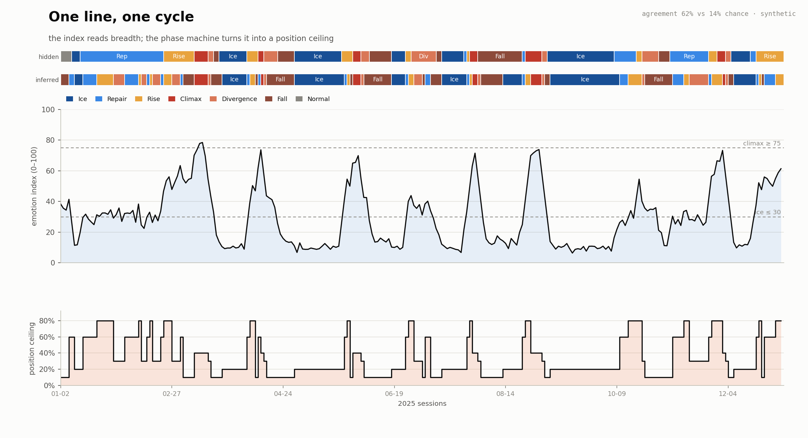
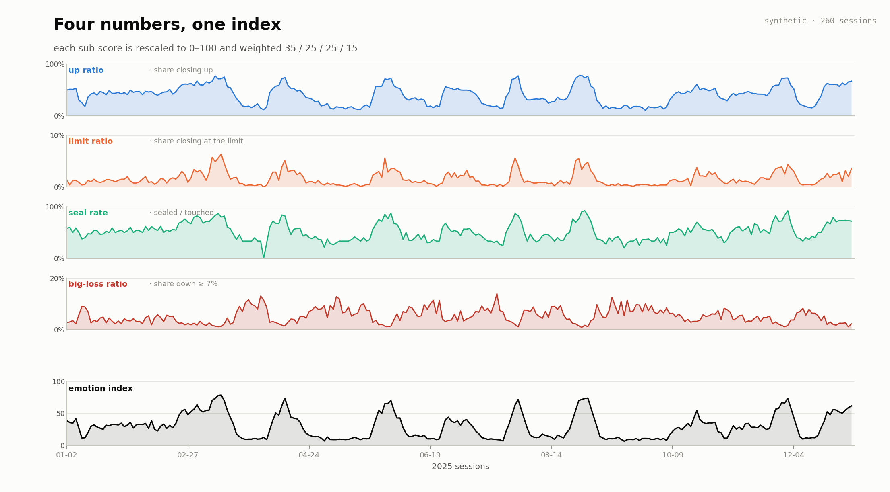
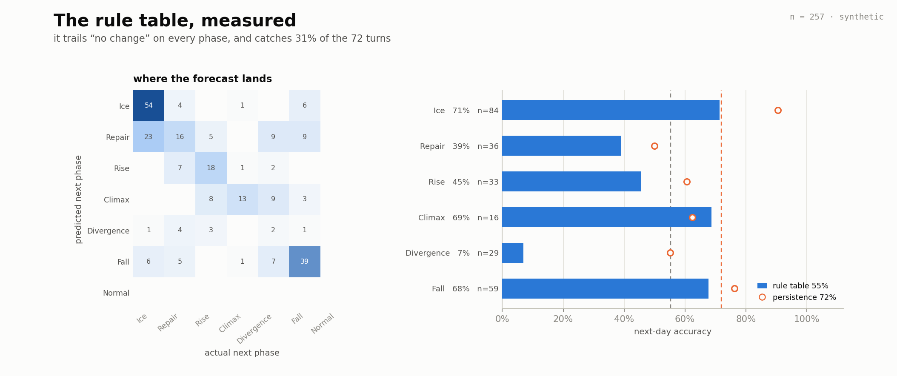
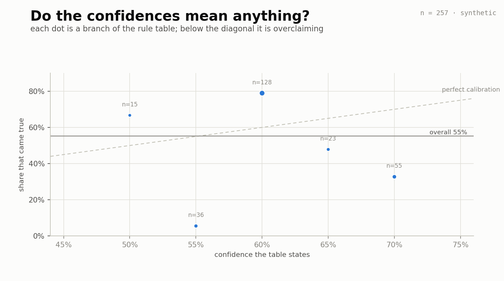
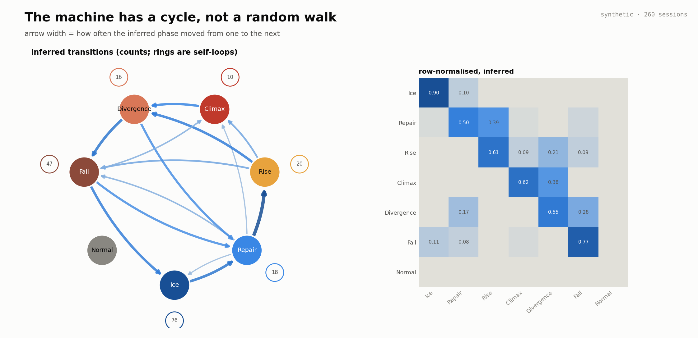

# Emotion-Cycle Forecast

**A 0–100 breadth index, a seven-phase state machine, and the scoreboard its
"tomorrow" prediction never had.**

Every close, the model reads four numbers off a sample of 800 stocks — how many
rose, how many closed at the limit, how many of those *sealed*, how many fell 7%
— turns them into an emotion index, classifies the tape into
*ice → repair → rise → climax → divergence → fall*, and maps the phase to a
position ceiling. Then it predicts tomorrow's phase from a hand-written table.

That last part is the interesting one. Every branch carries a confidence —
0.50, 0.55, 0.60, 0.65, 0.70 — that **nothing has ever checked**. This repo
checks it:

| | result |
|---|---|
| phase inferred = phase hidden (synthetic) | **61.5%** (chance 14.3%) |
| next-day forecast, overall | 55.3% vs **72.0%** for "tomorrow = today" |
| next-day forecast, on the 72 days that turned | **30.6%** vs 0% for persistence |
| the branch that claims 70% confidence | **32.7%** realised |

Pure standard-library core, 28 tests, five generated figures, and the original
module preserved verbatim in [`legacy/`](legacy/).

[English](README.md) | [中文](README.zh-CN.md)



---

## The question it answers

Every close, in one line:

> Is speculative appetite **expanding**, **holding**, or **contracting** — and
> what is the position ceiling for tomorrow?

The output is a phase and a ceiling, not a price target. The model does not
look at any single stock.

### The pipeline

| Stage | Input | Rule |
|---|---|---|
| Breadth | 800 stock-days | up_ratio · limit_ratio · **seal_rate** · big_loss_ratio |
| Index | four sub-scores | `0.35·limit + 0.25·up + 0.25·seal + 0.15·loss` |
| Smoothing | confidence by time of day | `y(1−c) + raw·c`, clamped to ±15/day |
| Phase | index + yesterday | ice / repair / rise / climax / divergence / fall / normal |
| Position | phase | 20% / 60% / 80% / **40%** / 30% / 10% / 50% |
| Forecast | phase + 7-day slope | a rule table with stated confidences |

The climax ceiling (40%) is *below* the rise ceiling (80%) — that is the
"reduce into strength" rule, written as arithmetic.



---

## Quick start

```bash
pip install -r requirements.txt

# Offline: 260 synthetic sessions, the full pipeline, five figures
python examples/demo_cycle.py

# Tests (standard library only)
python tests/test_core.py
python tests/test_forecast.py
python tests/test_pipeline.py
```

In a JoinQuant research environment:

```python
from src.emotioncycle.monitor import Monitor
from src.emotioncycle.jq_source import JQSource

monitor, source = Monitor(), JQSource()
state = monitor.update("2026-11-16", source.breadth("2026-11-16"), confidence=0.98)
state.phase, state.position, state.turns
monitor.forecast()      # main, alt, confidence, reason
```

As a pure library — no market data needed:

```python
from src.emotioncycle import Breadth, StockDay, measure, emotion_index, determine_phase

breadth = measure([StockDay(0.10, sealed=True, touched=True), StockDay(-0.02), ...])
emotion_index(breadth)          # 0–100
```

---

## What the benchmark says

`examples/demo_cycle.py` builds a market with a **hidden** phase (a Markov
chain), emits 800 stock-days per session from that phase's distribution, and
lets the model see only the breadth. It never sees the answer key.



| | |
|---|---|
| inferred = hidden | 61.5% (chance 14.3%, majority class 28.5%) |
| forecast vs persistence | 55.3% vs 72.0% |
| forecast on transition days | 30.6% of 72 |
| confidence 0.60 branch | 78.9% realised (n=128) |
| confidence 0.70 branch | 32.7% realised (n=55) |



Three conclusions, in order of importance:

1. **The state machine does read a cycle** — 4× chance on a regime it cannot see.
2. **The forecast loses to "no change" overall**, because phases are sticky.
3. **On the days that matter it catches a third**, where persistence catches
   none — and its stated confidences are not calibrated.

That last point is the reason this repo exists. A prediction is only as good as
the scoreboard behind it.

---

## Bugs this repo fixes

The module's v2.4 source is preserved verbatim in [`legacy/`](legacy/).

| # | Defect | Effect | Fix |
|---|---|---|---|
| 1 | `big_loss_score = 1 − count/40` | A **count** over a constant. Halve the sample and the same market reads twice as bad | `1 − big_loss_ratio / 0.05` |
| 2 | `seal_rate = 0.5` when nothing touched the limit | A dead market is scored as perfectly neutral (50) instead of unmeasurable | `None`, with an explicit neutral in the index |
| 3 | blending only while confidence < 0.60 | The output jumps by 0.41·(raw − yesterday) at the boundary — up to 16 points | continuous blending |
| 4 | climax − 4 points → `fall` | Skips `divergence`: the cycle jumps a rung | climax steps to divergence first |
| 5 | repair needs +5 in **one day** | A market climbing +3 a day never leaves `fall`, then jumps to `rise` | one-day **or** three-day change |
| 6 | divergence only reachable from `climax` | One day of lag in spotting the peak loses the whole divergence leg | also reachable from `rise` |
| 7 | forecast confidences are asserted | Seven branches, five constants, zero checks | `evaluate()`: overall, transition-day, calibration |
| 8 | diffusion history appends on every call | An intraday loop records 48 "days" per day | one update per session |

Also fixed: `random.seed(date)` reseeded the **global** RNG on every call; the
sample was drawn before filtering, so suspended names shrank it below 800.



---

## Repository layout

```
.
├── src/emotioncycle/
│   ├── breadth.py            # stock-days → four ratios (pure)
│   ├── index.py              # sub-scores, blending, clamp
│   ├── phases.py             # the seven-phase machine + signals
│   ├── forecast.py           # the rule table + the evaluator
│   ├── monitor.py            # stateful: one update per session
│   └── jq_source.py          # JoinQuant adapter (lazy import)
├── examples/
│   ├── demo_cycle.py         # hidden-phase market, five figures
│   ├── figures.py
│   └── figures/              # five PNGs
├── legacy/v2.4.py            # the original module, unmodified
├── notebooks/情绪因子2.ipynb
├── docs/算法总结.md           # full derivation (Chinese)
├── docs/公众号文章.md         # long-form write-up (Chinese)
├── tests/
└── requirements.txt
```

---

## Honest limitations

- **The synthetic market is not evidence about A-shares.** The hidden phase is
  what the generator says it is; 61.5% means "the rules recover a cycle this
  file injected", not "the A-share market has this cycle".
- **No backtest.** The position ceiling is a ceiling, not a return. There is no
  entry, no exit, no cost, no execution assumption.
- **Sampling error.** Limit-ups in 800 names carry ~0.3pp of standard error;
  the seal rate rests on twenty-odd attempts. The index is good to ±3 points.
- **The thresholds are folklore.** ±3, ±5, 4%, 70%, 60% were not fitted, and
  will not transfer to another market.
- **The machine lags by about a day** — hysteresis prevents flapping, and also
  guarantees you are late.
- **Confidence is not probability.** The table's numbers are adjectives.

Full derivation in [docs/算法总结.md](docs/算法总结.md) (Chinese), sections 7–9.

---

## Data & disclaimer

For research and education only — **not investment advice**.

## License

MIT
