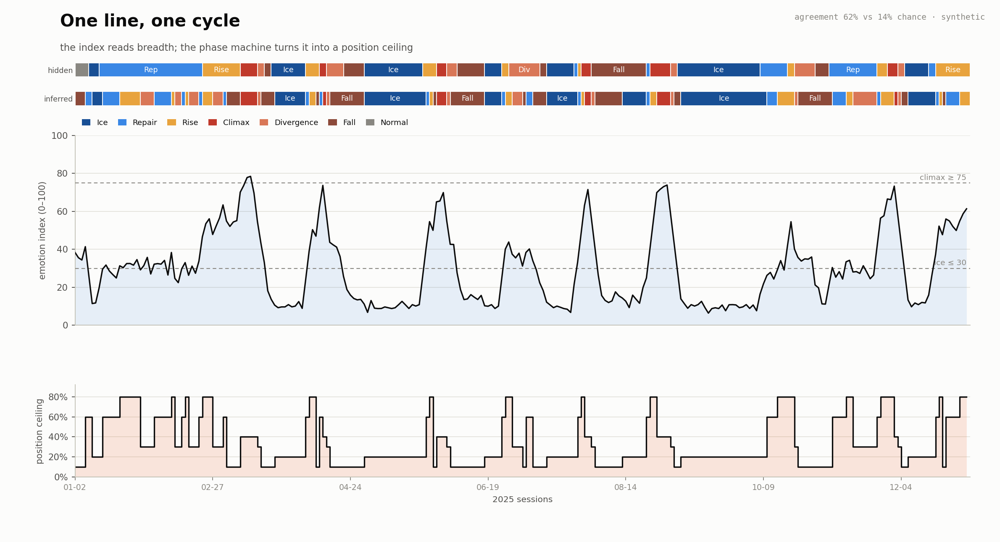
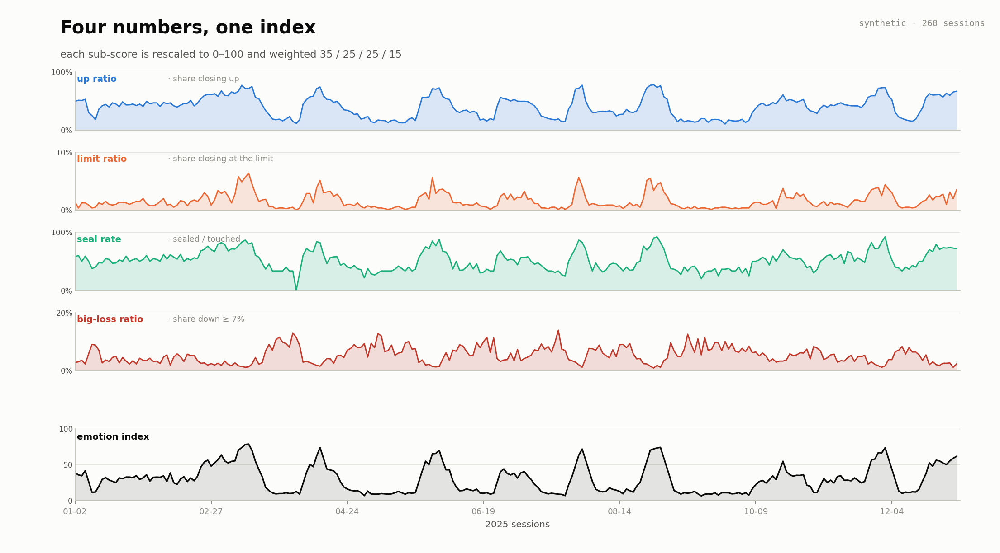
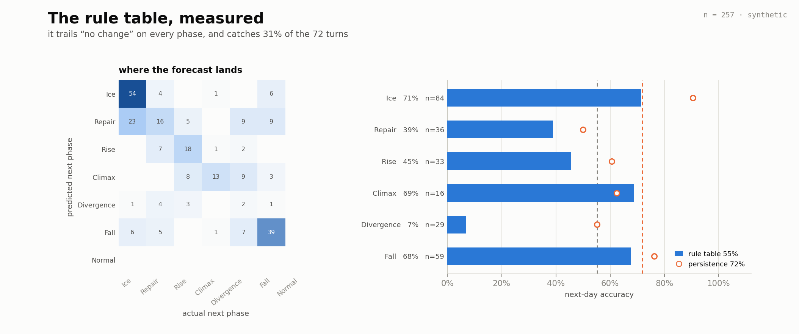
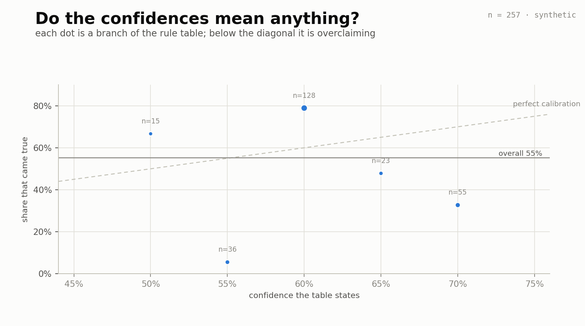
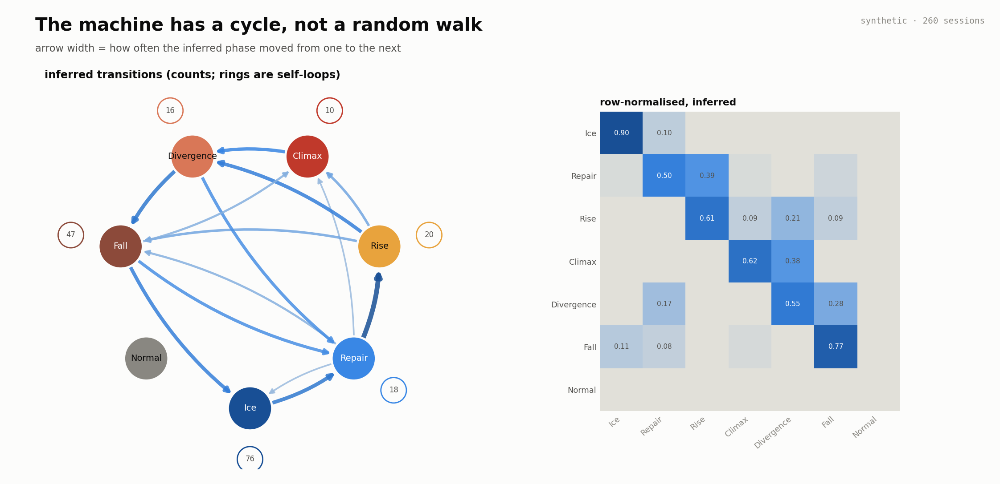

# 情绪周期与明日预判

**0–100 的宽度指数、七状态机，以及那个预测从来没拥有过的记分牌。**

每个收盘，模型从 800 只股票的抽样里读四个数字——多少票收涨、多少票涨停、
摸过涨停的票里多少封住、多少票跌 7% 以上——合成情绪指数，
把盘面归入 **冰点 → 修复 → 上升 → 高潮 → 分歧 → 退潮**，
再由阶段映射出仓位上限。最后，用一张手写的规则表**预判明天**。

最后这一步最值得说。每个分支都带一个置信度——0.50、0.55、0.60、0.65、0.70——
而**从来没有任何东西检验过它们**。这个仓库补上了检验：

| | 结果 |
|---|---|
| 推断阶段 = 隐藏阶段（合成） | **61.5%**（随机猜 14.3%） |
| 次日预判（整体） | 55.3%，"明天 = 今天"是 **72.0%** |
| 次日预判（阶段真的切换的 72 天） | **30.6%**，持久性是 0% |
| 声称 70% 置信度的分支 | 实际兑现 **32.7%** |

核心是纯标准库，28 个测试，五张自动生成的图，原始模块逐字保留在 `legacy/`。

[English](README.md) | [中文](README.zh-CN.md)



---

## 它回答什么问题

每个收盘，一句话：

> 投机的胃口在**扩张**、**维持**，还是**收缩**——明天的仓位上限是多少？

输出是一个阶段和一个仓位上限，不是价格目标。模型不看任何单只股票。

### 流水线

| 阶段 | 输入 | 规则 |
|---|---|---|
| 宽度 | 800 个股票日 | 上涨比例 · 涨停比例 · **封板率** · 大跌比例 |
| 指数 | 四个子分数 | `0.35·涨停 + 0.25·上涨 + 0.25·封板 + 0.15·亏损` |
| 平滑 | 按时间给置信度 | `昨收(1−c) + 原始·c`，单日夹逼 ±15 |
| 阶段 | 指数 + 昨日 | 冰点 / 修复 / 上升 / 高潮 / 分歧 / 退潮 / 正常 |
| 仓位 | 阶段 | 20% / 60% / 80% / **40%** / 30% / 10% / 50% |
| 预判 | 阶段 + 7 日斜率 | 一张带置信度的规则表 |

高潮期的仓位上限（40%）**低于**上升期（80%）——这就是"在强势里减仓"，
写成了一道算术。



---

## 快速开始

```bash
pip install -r requirements.txt

# 离线：260 个合成交易日，完整流水线，五张图
python examples/demo_cycle.py

# 测试（纯标准库）
python tests/test_core.py
python tests/test_forecast.py
python tests/test_pipeline.py
```

聚宽研究环境内：

```python
from src.emotioncycle.monitor import Monitor
from src.emotioncycle.jq_source import JQSource

monitor, source = Monitor(), JQSource()
state = monitor.update("2026-11-16", source.breadth("2026-11-16"), confidence=0.98)
state.phase, state.position, state.turns
monitor.forecast()      # 主预判、备选、置信度、理由
```

当成纯库用（不需要任何行情）：

```python
from src.emotioncycle import Breadth, StockDay, measure, emotion_index

breadth = measure([StockDay(0.10, sealed=True, touched=True), StockDay(-0.02)])
emotion_index(breadth)      # 0–100
```

---

## 基准测试的结论

`examples/demo_cycle.py` 造了一个带**隐藏阶段**的市场（马尔可夫链），
每个交易日照该阶段的分布生成 800 只股票，模型只看得到宽度。它看不到答案。



| | |
|---|---|
| 推断 = 隐藏 | 61.5%（随机 14.3%，多数类 28.5%） |
| 预判 vs 持久性 | 55.3% vs 72.0% |
| 转移日命中率 | 30.6%（72 天） |
| 置信度 0.60 的分支 | 实际 78.9%（n=128） |
| 置信度 0.70 的分支 | 实际 32.7%（n=55） |



三条结论，按重要性排列：

1. **状态机确实在读周期**——在一个它看不见的隐藏阶段上，命中率是随机猜测的四倍。
2. **预判整体上打不过"不变"**，因为阶段大多数时候不变。
3. **在真正要紧的那几天它抓到了三分之一**，而持久性一个都抓不到——
   同时它标称的置信度是失准的。

最后一条是这个仓库存在的理由：**一个预测值多少，取决于它背后有没有记分牌。**

---

## 修了哪些 bug

v2.4 的源码逐字保留在 [`legacy/`](legacy/)。

| # | 缺陷 | 后果 | 修复 |
|---|---|---|---|
| 1 | `big_loss_score = 1 − 家数/40` | 分子是**家数**、分母是常数。样本减半，同一个市场读起来差一倍 | 用比例 `1 − big_loss_ratio/0.05` |
| 2 | 无人摸涨停时 `seal_rate = 0.5` | 死掉的市场被打成"中性 50 分"，而不是"无法测量" | 返回 `None`，在指数里显式取中性 |
| 3 | 只在置信度 < 0.60 时混合 | 0.599→0.600 之间输出跳变 0.41×(原始−昨收)，最高 16 分 | 始终连续混合 |
| 4 | 高潮跌 4 点 → 判"退潮" | 跳过"分歧"，周期跳级 | 高潮只能先到分歧 |
| 5 | 修复要求**单日**涨 5 点 | 每天涨 3 点的温和修复永远走不出退潮，直接跳"上升" | 单日 **或** 三日累计 |
| 6 | 分歧只能从"高潮"进入 | 峰值晚识别一天，整段分歧全部丢失 | 上升也能转入分歧 |
| 7 | 预判置信度是断言 | 七个分支、五个常数、零检验 | `evaluate()`：整体 / 转移日 / 校准 |
| 8 | 扩散度在每次调用时追加 | 盘中循环一天记 48 条"日"数据 | 每个交易日只允许一次更新 |

另外：`random.seed(date)` 重置的是**全局**随机数发生器；样本先抽后过滤，
停牌股被逐个丢弃，导致"800 只"其实不足 800。



---

## 目录结构

```
.
├── src/emotioncycle/
│   ├── breadth.py            # 股票日 → 四个比例（纯函数）
│   ├── index.py              # 子分数、混合、夹逼
│   ├── phases.py             # 七状态机 + 转折信号
│   ├── forecast.py           # 规则表 + 评估器
│   ├── monitor.py            # 有状态：每个交易日一次更新
│   └── jq_source.py          # 聚宽适配器（惰性导入）
├── examples/
│   ├── demo_cycle.py         # 隐藏阶段市场、五张图
│   ├── figures.py
│   └── figures/              # 五张 PNG
├── legacy/v2.4.py            # 原始模块，未改动
├── notebooks/情绪因子2.ipynb
├── docs/算法总结.md
├── docs/公众号文章.md
├── tests/
└── requirements.txt
```

---

## 诚实的局限

- **合成市场不能证明 A 股有这种周期。** 隐藏阶段是生成器定义的；
  61.5% 的意思是"规则能捞回这个文件注入的周期"。
- **不是回测。** 仓位上限不是收益，没有买点、卖点、成本、成交假设。
- **抽样误差。** 800 只里的涨停家数标准误约 0.3 个百分点；封板率只由
  二十来次摸板决定。指数的有效精度大约 ±3 分。
- **阈值是经验。** ±3、±5、4%、70%、60% 都没经过拟合，换市场要重设。
- **状态机滞后约一天**——滞回防抖，也保证你总是晚一步。
- **置信度不是概率。** 表里的数字是形容词。

完整推导见 [docs/算法总结.md](docs/算法总结.md) 第 7–9 节。

---

## 数据与声明

仅供研究与学习，**不构成投资建议**。

## 许可证

MIT
